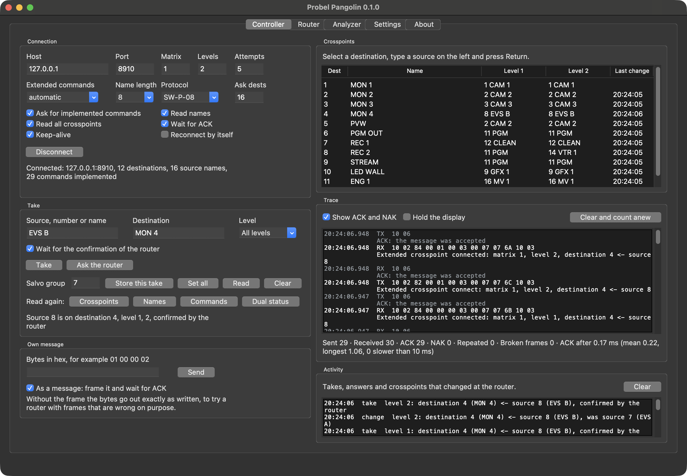
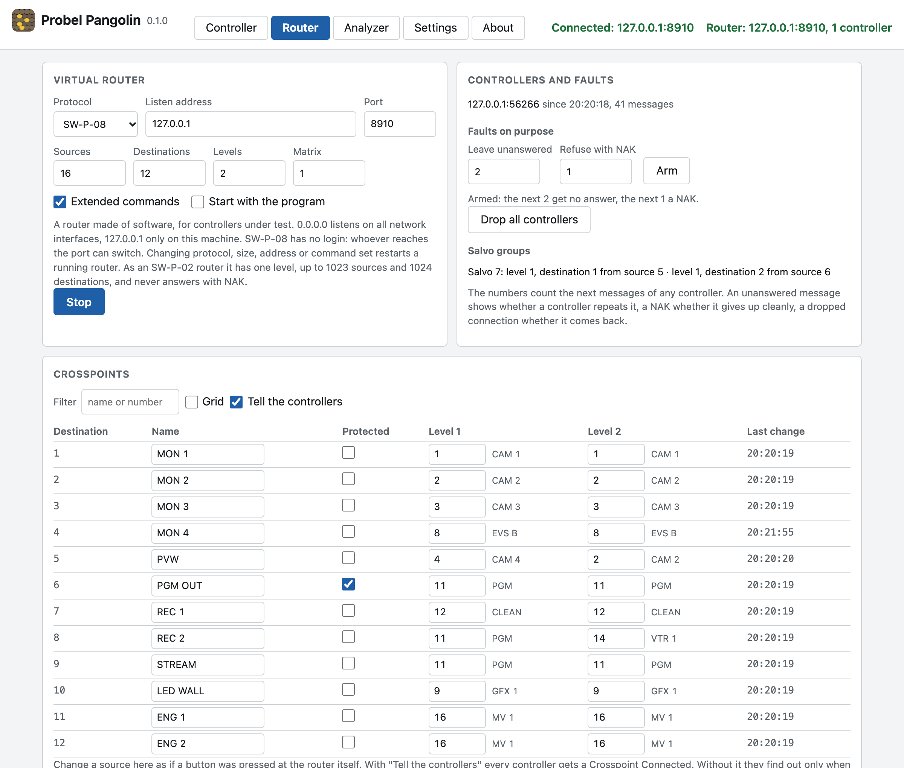

<p align="center">
  
</p>

# Probel Pangolin

Probel Pangolin controls broadcast routers over SW-P-08 and SW-P-02, the
router control protocols of Pro-Bel, later Snell, now Grass Valley. It is a
test tool: switch a crosspoint and see whether the router follows, be a
router yourself and see what a controller really sends, and read every frame
on the wire in plain words.

It runs on macOS, Windows and Linux.



## What it does

- **Controller:** connects to a router or router controller, switches
  crosspoints by number or name, on one level or on all, reads names and the
  complete state, stores takes in salvo groups and fires them, and follows
  what other panels switch. As a table or as a grid where one click is a take.
- **Router:** a router made of software that any controller can connect to.
  Sources, destinations, levels and names are yours to set. Destinations can
  be protected, and faults can be put in on purpose: messages that get no
  answer, messages that are refused, connections that drop.
- **Trace:** every frame that crossed the wire, on both sides, with time,
  direction, bytes and meaning. Counters for ACK, NAK, repeated messages and
  broken frames, and how long the router took to acknowledge.
- **Analyzer:** reads captured bytes from a sniffer or from Wireshark, checks
  byte count and checksum, says what each message means, and builds messages
  byte by byte.
- **Two protocols:** SW-P-08, the General Remote Control Protocol, with its
  extended commands for large routers, and SW-P-02, the older General
  Switcher protocol. See [the protocols as the program speaks them](docs/protocols.md).
- **Four ways to use it,** all on the same controller and the same virtual
  router: a desktop window, a web interface, a [REST API](docs/rest-api.md)
  for other programs, and the Python library
  [probelpangolin](https://github.com/MarcusMa-dotcom/probel-pangolin-lib) to
  build the protocols into your own software.
- **Access control:** web interface and REST API can be switched off
  separately, each with its own optional login. Passwords are stored as a
  salted hash.



## Documentation

| Page | Content |
|---|---|
| [Using Probel Pangolin](docs/usage.md) | Every view with pictures, the first five minutes, how to test a real router and how to test a controller |
| [REST API](docs/rest-api.md) | Every endpoint, what the answers hold, a session from start to end |
| [The protocols](docs/protocols.md) | Frames and messages of SW-P-08 and SW-P-02 byte by byte, sources, and what is not covered |
| [How it is built](docs/architecture.md) | Library, engines, threads, web server, files |

## Download for the Mac

`Probel-Pangolin-macOS.zip` on the
[releases page](https://github.com/MarcusMa-dotcom/probel-pangolin/releases/latest)
holds `Probel Pangolin.app`. It carries Python and everything else it needs,
for Macs with Apple silicon and macOS 11 or newer.

The app is not signed with a developer certificate. The first time, open it
with a right-click and **Open**, or allow it under System Settings, Privacy
and Security.

## Install from source

Python 3.10 or newer.

```bash
python -m venv .venv
```

```bash
.venv/bin/pip install -r requirements.txt
```

On Windows the second command is `.venv\Scripts\pip install -r requirements.txt`.
`requirements.txt` takes Flask from the package index and the library
straight from [its repository](https://github.com/MarcusMa-dotcom/probel-pangolin-lib)
at a fixed tag. `requirements-tested.txt` holds the exact versions this
release was tested with.

The desktop window needs Tk. It comes with the Python installers from
python.org. Elsewhere install it separately: `python3-tk` on Debian and Ubuntu,
`python-tk` with Homebrew. Without Tk the program still runs without window.

## Start

```bash
.venv/bin/python -m probelpangolin_app
```

This opens the window and serves the web interface on <http://localhost:8090/>
and the REST API on <http://localhost:8090/api/v1/>.

| Option | Effect |
|---|---|
| `--router` | Start the virtual router on its SW-P-08 port right away |
| `--connect` | Connect the controller to its router right away |
| `--no-gui` | No window, for a machine without a screen |
| `--no-web` | No web server: neither web interface nor REST API |
| `--port 8090` | Port of the web server |
| `--host 0.0.0.0` | Make the web server reachable from other machines |
| `--tls-cert FILE --tls-key FILE` | Serve over HTTPS |
| `--config FILE` | Settings file to use |
| `--web on` / `--web off` | Switch the web interface on or off |
| `--api on` / `--api off` | Switch the REST API on or off |
| `--web-login USER` / `--no-web-login` | Require a login for the web interface, or not |
| `--api-login USER` / `--no-api-login` | Require a login for the REST API, or not |

`--port` and `--host` belong to the web server. The SW-P-08 addresses are set
in the Controller tab (where to connect to) and in the Router tab (where to
listen), both with port 8910 unless changed.

The four access options are saved, like changes in the Settings tab. A login
option asks for the password in the terminal. Without a terminal it reads the
password from `PROBEL_PANGOLIN_WEB_PASSWORD` or `PROBEL_PANGOLIN_API_PASSWORD`.
Passwords are never taken from the command line.

Settings, the names, crosspoints and protected destinations of the virtual
router are saved when they change and loaded at the next start.

## The first five minutes

Start the program. In **Router** press **Start**. In **Controller** press
**Connect** (127.0.0.1, port 8910). Sixteen destinations appear with their
names. Type `5` into a row and press Return, or switch on **Grid** and click.
The trace shows the connect, the ACK, the Crosspoint Connected of the router
and the ACK that goes back.

Then make it harder. In **Router** protect a destination and take a source to
it from the controller: the take is refused and the reason shown. Set **Leave
unanswered** to 1, press **Arm** and take again: the trace shows the repeated
message and "Repeated 1". Store two takes in a salvo group and press **Set all
at once**: both destinations change in the same moment, and the trace shows
that the router answers with one acknowledge instead of two Connected. Change a source in the Router tab: the controller
follows, and Activity names the change.

More in [Using Probel Pangolin](docs/usage.md).

## From other programs

```bash
curl -X POST http://localhost:8090/api/v1/controller/route -H 'Content-Type: application/json' -d '{"source": 5, "dest": 3, "levels": "all"}'
```

```python
from probelpangolin import Router

with Router("10.0.0.20", levels=2, fetch_names=True) as router:
    router.route("CAM 5", "MON 3", level=router.all_levels, confirm=True)
    print(router.get_route(3))
```

The first is the [REST API](docs/rest-api.md) of this program, the second the
[library](https://github.com/MarcusMa-dotcom/probel-pangolin-lib) on its own.

## Security in short

- By default the web server answers on this machine only and needs no login.
- With `--host 0.0.0.0` it is reachable from the network. Then require logins
  and use HTTPS (`--tls-cert`, `--tls-key`): without HTTPS, passwords cross the
  network unencrypted. The program warns in the terminal and in Settings.
- The virtual router listens on `127.0.0.1` until you change its listen
  address. SW-P-08 has no login and no encryption: whoever reaches the port can
  switch. The virtual router switches nothing real.
- The controller switches a real router if you connect it to one. Whoever may
  use the web interface or the API can make this machine connect to any
  address and port and send any bytes there. Give access only to people who
  should have it, and try things on the virtual router first.
- After five failed logins from one address, that address has to wait.
- Data from the network is never trusted: frames with a wrong byte count or
  checksum are answered with NAK, counted and shown, and the connection goes on.

## Tests

```bash
.venv/bin/pip install pytest
```

```bash
.venv/bin/python -m pytest
```

The tests let the controller and the virtual router of the program talk over
real TCP connections on this machine and drive the REST API through Flask's
test client. The library has its own tests.

## Build the Mac app

`packaging/` holds the recipe for a single program file, `Probel Pangolin.app`,
that carries Python, Tk, Flask and the library, so the Mac it runs on needs
nothing installed. Build it in an environment of its own, with program and
library installed as copies, not as links to the source folders:

```bash
python3 -m venv build-venv
```

```bash
build-venv/bin/pip install -r requirements-tested.txt pyinstaller
```

```bash
build-venv/bin/pip install --no-deps .
```

```bash
build-venv/bin/pyinstaller --noconfirm packaging/probel_pangolin.spec
```

The app appears in `dist/`. It runs on the processor type of the Python it was
built with, from the macOS version that Python targets. The app of 11 November
2026 was built with CPython 3.13.18 from python-build-standalone for Apple
silicon, macOS 11 or newer, and is 31 MB. It is signed ad hoc, not with a
developer certificate: it starts on the Mac it was built on, another Mac asks
for confirmation the first time (right-click, Open).

`packaging/make_icon.py` draws the placeholder logo and, on a Mac, the icon
file `packaging/Probel Pangolin.icns`.

## Siblings

Probel Pangolin is the third of a family of test tools for broadcast control
protocols, all built the same way: a desktop window, a web interface, a REST
API and a library of their own.

| Tool | Protocol | Library |
|---|---|---|
| [Tally Tapir](https://github.com/MarcusMa-dotcom/tally-tapir) | TSL UMD tally, V3.1, V4.0 and V5.0, over UDP, TCP and serial | [tally-tapir-lib](https://github.com/MarcusMa-dotcom/tally-tapir-lib) |
| [Ember Emu](https://github.com/MarcusMa-dotcom/ember-emu) | Ember+: serves a virtual tree and reads the tree of any provider | [ember-emu-lib](https://github.com/MarcusMa-dotcom/ember-emu-lib) |
| Probel Pangolin | SW-P-08 and SW-P-02 router control | [probel-pangolin-lib](https://github.com/MarcusMa-dotcom/probel-pangolin-lib) |

## Not tested against hardware yet

The program was tested against its own virtual router, with the examples of
the specification and the test vectors of the Bitfocus Companion module, not
yet against a hardware router. What the public specification leaves out is
listed under [Not covered](docs/protocols.md#not-covered). Reports from real
routers are welcome as issues.

## License

MIT License. Copyright (c) 2026 Marcus Mathy. Use at your own risk: the
software comes as is, without warranty of any kind. The full text is in
[LICENSE](LICENSE).

SW-P-08 is the General Remote Control Protocol of Pro-Bel, later Snell and
Grass Valley. This program is an independent implementation and is not
affiliated with Grass Valley. Framing and the main commands follow the
specification SW-P-88 Router Control Protocols, the extended commands and the
name messages the MIT-licensed Bitfocus Companion module generic-swp08
(© Bitfocus AS).
