# Using Probel Pangolin

The desktop window and the web interface show the same views and control the
same controller and the same virtual router. What you change in one appears
in the other. The pictures on this page show both.

- [Starting](#starting)
- [The first five minutes, without hardware](#the-first-five-minutes-without-hardware)
- [Controller: a router on the network](#controller-a-router-on-the-network)
- [Router: a router made of software](#router-a-router-made-of-software)
- [Analyzer: bytes and their meaning](#analyzer-bytes-and-their-meaning)
- [SW-P-02 as an option](#sw-p-02-as-an-option)
- [Settings: who may reach the program](#settings-who-may-reach-the-program)
- [The desktop window](#the-desktop-window)
- [Where settings are stored](#where-settings-are-stored)
- [Testing a real router](#testing-a-real-router)
- [Testing a controller](#testing-a-controller)

## Starting

Open `Probel Pangolin.app`, or start from the source folder:

```bash
.venv/bin/python -m probelpangolin_app
```

This opens the window and serves the web interface on <http://localhost:8090/>
and the REST API on <http://localhost:8090/api/v1/>.

| Option | Effect |
|---|---|
| `--router` | Start the virtual router on its SW-P-08 port right away |
| `--connect` | Connect the controller to its router right away |
| `--no-gui` | No window, for a machine without a screen |
| `--no-web` | No web server: neither web interface nor REST API |
| `--port 8090` | Port of the web server |
| `--host 0.0.0.0` | Make the web server reachable from other machines |
| `--tls-cert FILE --tls-key FILE` | Serve over HTTPS |
| `--config FILE` | Settings file to use |
| `--web on` / `--web off` | Switch the web interface on or off |
| `--api on` / `--api off` | Switch the REST API on or off |
| `--web-login USER` / `--no-web-login` | Require a login for the web interface, or not |
| `--api-login USER` / `--no-api-login` | Require a login for the REST API, or not |

`--port` and `--host` belong to the web server. The SW-P-08 addresses are set
in the Controller tab (where to connect to) and in the Router tab (where to
listen), both with port 8910 unless changed.

The four access options are saved, like changes in the Settings tab. A login
option asks for the password in the terminal. Without a terminal it reads the
password from `PROBEL_PANGOLIN_WEB_PASSWORD` or `PROBEL_PANGOLIN_API_PASSWORD`.
Passwords are never taken from the command line.

Settings, the names, crosspoints and protected destinations of the virtual
router are saved when they change and loaded at the next start.

## The first five minutes, without hardware

Start the program. In **Router** press **Start**. In **Controller** press
**Connect** (127.0.0.1, port 8910). Sixteen destinations appear with their
names. Type `5` into a row and press Return, or switch on **Grid** and click.
The trace shows the connect, the ACK, the Crosspoint Connected of the router
and the ACK that goes back.

Then make it harder. In **Router** protect a destination and take a source to
it from the controller: the take is refused and the reason shown. Set **Leave
unanswered** to 1, press **Arm** and take again: the trace shows the repeated
message and "Repeated 1". Store two takes in a salvo group and press **Set all
at once**: both destinations change in the same moment, and the trace shows
that the router answers with one acknowledge instead of two Connected. Change a source in the Router tab: the controller
follows, and Activity names the change.

## Controller: a router on the network

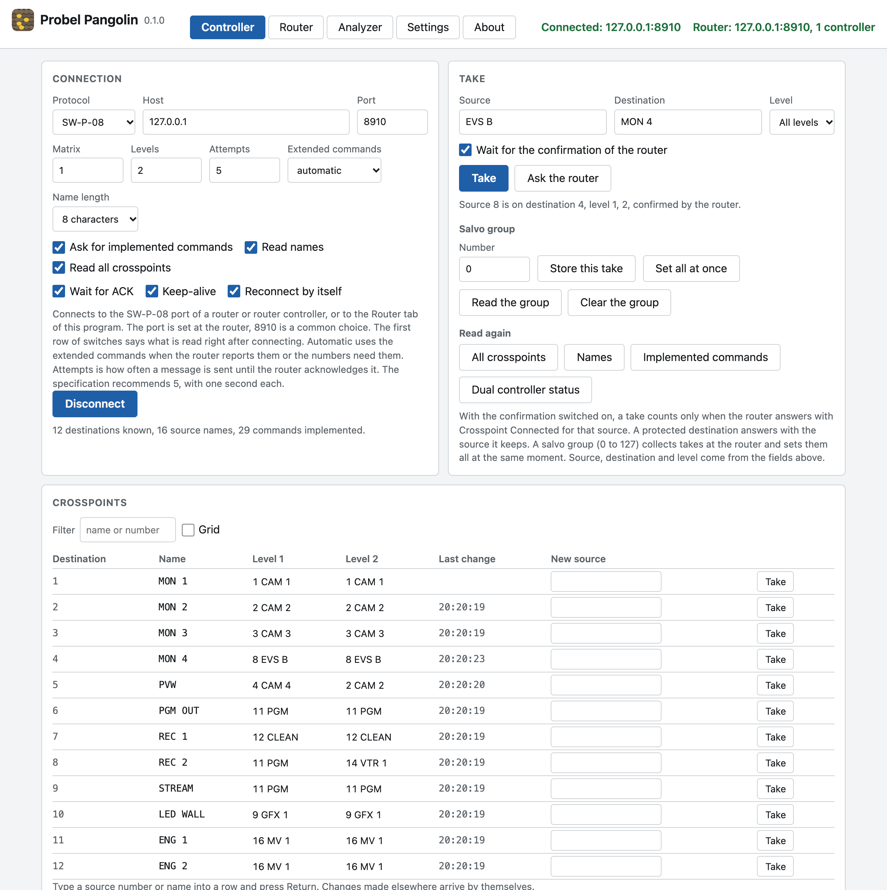

| Control | Meaning |
|---|---|
| Protocol | SW-P-08 or SW-P-02 |
| Host, Port | The control port of the router or router controller |
| Destinations to ask | SW-P-02 only: how many destinations "Read all crosspoints" asks one by one |
| Matrix, Levels | Which matrix to talk to, and how many levels it has |
| Extended commands | automatic: use them when the router reports them or the numbers need them. always, never: force it |
| Name length | 4, 8 or 12 characters, as asked for when names are read |
| Ask for implemented commands, Read names, Read all crosspoints | What is read right after connecting, and again after every reconnect |
| Attempts | How often a message is sent until the router acknowledges it, one second each. The specification recommends 5 |
| Wait for ACK | Switch off for devices that never acknowledge |
| Keep-alive | After 30 seconds of silence a crosspoint interrogate checks the connection |
| Reconnect by itself | Connect again when the connection is lost or the router is not there yet |
| Take | Route a source to a destination, by number or by name, on one level or on all |
| Wait for the confirmation of the router | A take counts only when the router answers with Crosspoint Connected for that source. A protected destination answers with the source it keeps, and the take is reported as refused |
| Ask the router | Crosspoint interrogate for the destination |
| Salvo group | A salvo group (0 to 127) collects takes at the router and sets them all at the same moment. Store this take puts source, destination and level of the form into the group, Set all at once fires it, Read and Clear show or empty it. The router sends no Crosspoint Connected for a salvo: the program follows its acknowledges instead |
| Read again | All crosspoints (tally dump), names, implemented commands, and the dual controller status of a router with two controllers |
| Crosspoints | One row per destination with its source on every level, and when it last changed. Type a source into a row and press Return. Grid shows sources across and destinations down: one click is a take |
| Trace | Every frame as it crossed the wire, with time, direction, bytes and meaning. ACK and NAK can be hidden, the display can be held, Export saves the whole trace as JSON |
| Own message | Hex bytes sent as a message (frame added, ACK awaited) or exactly as written, to try a router with frames that are wrong on purpose |
| Implemented commands | What the router answered to the protocol implementation request, with the direction of every command: sent by the router, or accepted by it |
| Activity | Takes, answers, refusals, and crosspoints that someone else changed |

Above the trace the program counts: messages sent and received, ACK and NAK,
repeated messages, broken frames, and how long the router took for its ACK:
latest, mean, longest, and how many took longer than the 10 milliseconds the
specification asks for.

### The grid

Switch on **Grid** above the crosspoint table for the classic matrix view:
sources across, destinations down, one level at a time. A click on a cell is
a take. The grid shows up to 64 sources and 64 destinations. Without names
it has as many sources as the highest one that is routed.

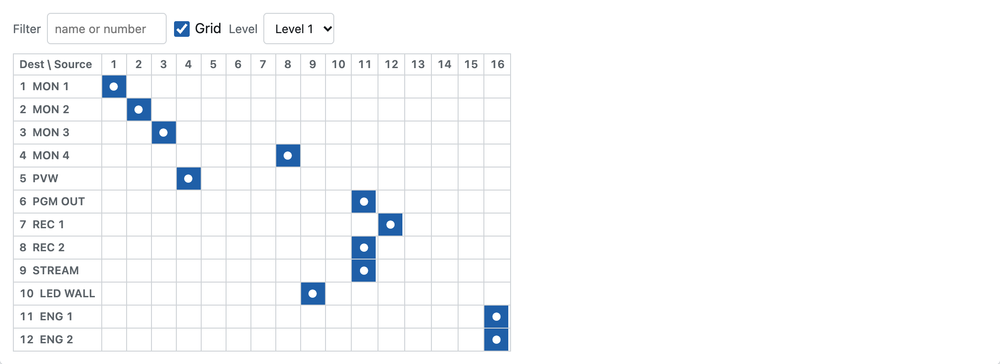

### The trace

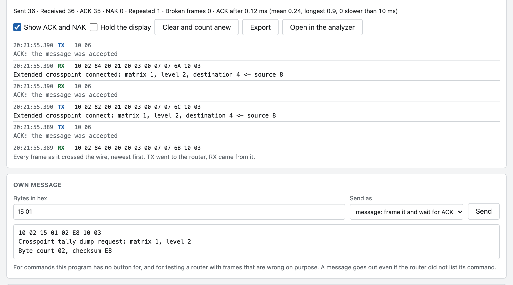

Every line is one thing that crossed the wire: the time to the millisecond,
the direction (TX went to the router, RX came from it), the bytes as they
travelled, and below them what they mean. A message that was repeated says
which attempt it was. Lines in red are what went wrong: a NAK, a broken
frame, a repeated message, a message that could not be decoded.

- **Show ACK and NAK** hides the two-byte acknowledges when only the messages
  matter.
- **Hold the display** freezes the list for reading and copying. The trace
  keeps growing behind it.
- **Clear and count anew** empties the trace and sets the counters to zero.
- **Export** saves everything the trace holds, up to 5000 entries, as JSON.
- **Open in the analyzer** hands the frames to the Analyzer view.

**Own message** sends bytes of your own. As a message, the program adds the
frame and waits for the ACK, and the line below the field shows the frame it
will become. As bytes exactly as written, nothing is added: this is how to
send a frame with a wrong checksum or a wrong byte count on purpose and see
whether the router answers with NAK.

### What the router implements, and what happened

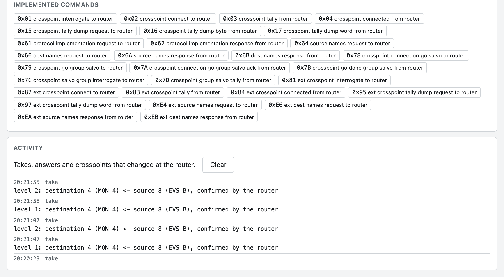

**Implemented commands** lists what the router answered to the protocol
implementation request, each with its direction. The program refuses to send
a command the router did not list. An own message goes out anyway.

**Activity** is the story in words: every take with its outcome, every
answer to a question, every refusal, and every crosspoint that changed
without this program asking for it, with the source it had before.

## Router: a router made of software

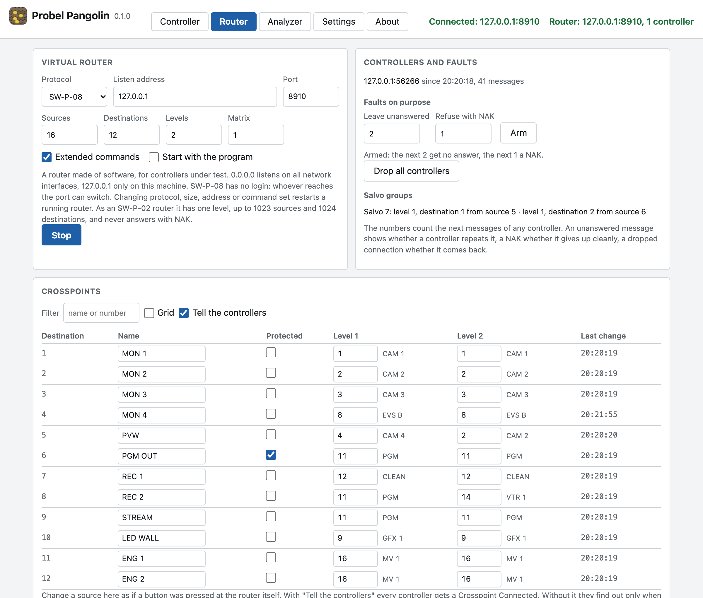

| Control | Meaning |
|---|---|
| Protocol | SW-P-08 or SW-P-02. As an SW-P-02 router it has one level, up to 1023 sources and 1024 destinations, and no NAK |
| Listen address, Port | Where controllers connect. `0.0.0.0` listens on all network interfaces, `127.0.0.1` only on this machine |
| Sources, Destinations, Levels, Matrix | The size of the router: up to 4096 sources and destinations, 32 levels. A router with more than 1024 sources or destinations or more than 16 levels needs the extended commands |
| Extended commands | Whether the router answers and reports the extended commands |
| Start with the program | Open the port at every start |
| Start / Stop | Opens or closes the SW-P-08 port |
| Controllers | Who is connected, since when, and how many messages they sent |
| Salvo groups | What controllers have stored in salvo groups and not set yet |
| Leave unanswered, Refuse with NAK | The next messages of any controller get no ACK and no answer, or a NAK |
| Drop all controllers | Closes every connection, to see whether a controller comes back |
| Crosspoints | Name, protection and the source of every destination on every level, all to change right there. Grid: one click sets a crosspoint |
| Tell the controllers | A change made here goes out as Crosspoint Connected. Without it controllers find out only when they ask |
| Source names | The names the router hands out |
| Trace, Activity | Every frame with the controller it belongs to, and what controllers asked for |

The virtual router answers crosspoint connect and interrogate, tally dump
requests (byte format up to 191 sources and destinations, word format
otherwise, 64 tallies per message), source and destination name requests in
4, 8 and 12 characters, and the protocol implementation request, each in the
standard and the extended form. It keeps salvo groups: connect on go, go,
clear and interrogate, with their acknowledges sent to every controller. A
take on a protected destination is answered with the source the destination
keeps, and a salvo leaves a protected destination alone.

## Analyzer: bytes and their meaning

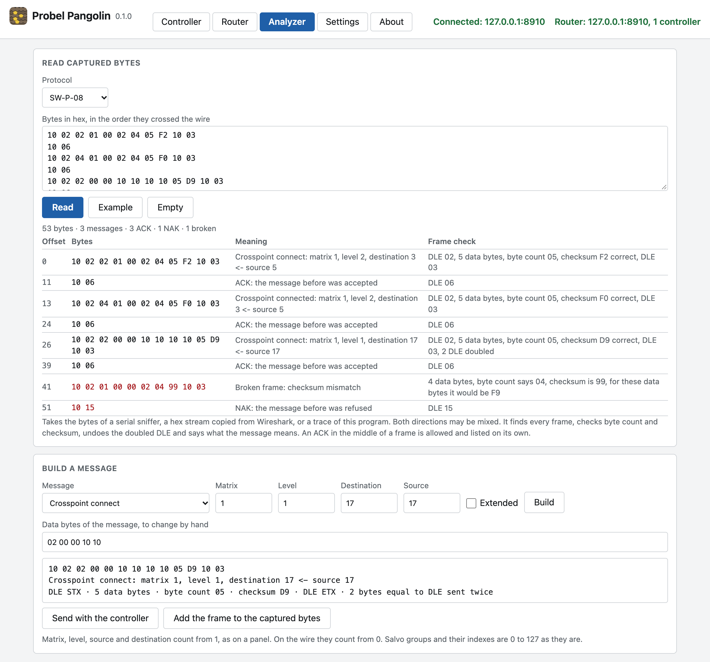

**Read captured bytes** takes hex text from a serial sniffer, a hex stream
copied from Wireshark, or a trace of this program ("Open in the analyzer").
Both directions may be mixed. It lists every frame with its offset, checks
byte count and checksum, undoes the doubled DLE and says what the message
means. Bytes outside a frame, broken frames and a frame cut off at the end are
shown as such, with the checksum the data bytes would have needed. An ACK
that arrives in the middle of a frame is allowed by the specification: it is
listed on its own and the frame is read as a whole.

**Build a message** puts together the messages a controller sends: crosspoint
connect and interrogate, tally dump request, name requests and the protocol
implementation request, standard or extended, the four salvo messages and the
dual controller status request. A message longer than the 128 data bytes that
every system is guaranteed to accept is marked. The data bytes can be changed by
hand. Below them the complete frame appears with byte count and checksum. The
message can be sent with the controller or added to the captured bytes.

Messages the program has no parser for (protects, UMD labels, tie lines and
so on) are shown with the name of their command and their bytes.

## SW-P-02 as an option

SW-P-02, the General Switcher Communication Protocol, is the older and
simpler sibling. Choose it under **Protocol** in the Controller tab, the
Router tab and the Analyzer. What changes with it:

| | SW-P-08 | SW-P-02 |
|---|---|---|
| Message | `DLE STX`, data, byte count, checksum, `DLE ETX` | `FF`, command, message, 7-bit checksum. The command says how long the message is |
| Acknowledge | `DLE ACK` or `DLE NAK` for every frame | none. The CONNECTED or TALLY of the router is the confirmation |
| Addressing | matrix, level, destination, source | destination and source only: one level |
| Size | 1024, with extended commands 65536 | 1024 destinations, 1023 sources |
| Whole state | tally dump | none. The program asks the destinations one by one |
| Names, implemented commands | yes | no |
| Stored takes | 128 numbered salvo groups | one store: CONNECT ON GO, then GO |
| After a stored set | acknowledges tell every controller | no message. The program asks the destinations again |
| Usual TCP port | set at the router, often 8910 | 2000 |

Switching the protocol moves the port between 8910 and 2000 if it was on the
usual one. Controls that the chosen protocol has no use for are switched off.
A destination that does not exist is answered by an SW-P-02 router with a
reserved source number, shown as "out of range".

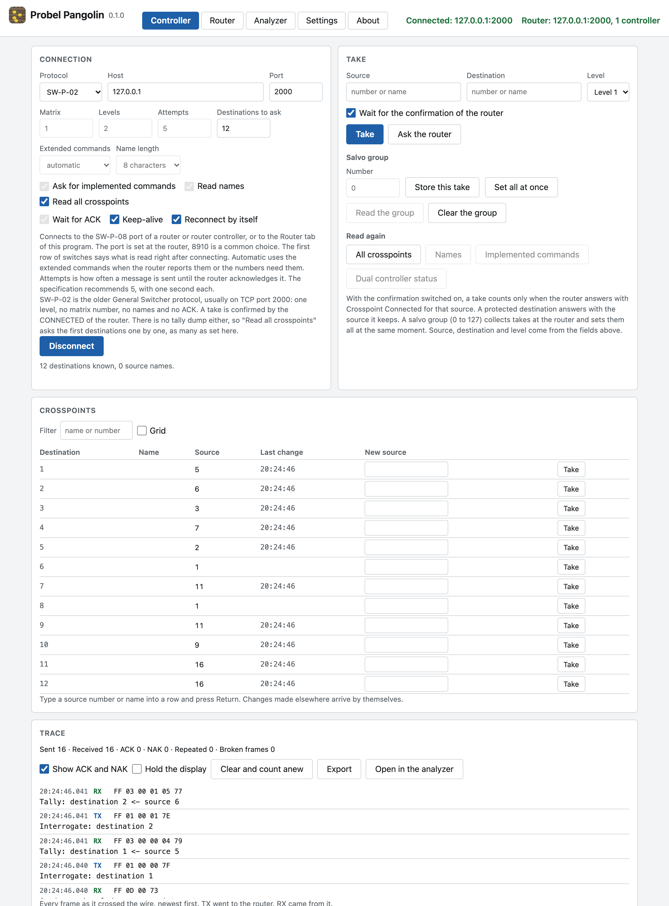

The analyzer reads SW-P-02 the same way. A message whose command has no
known length is listed as not readable, up to the next start of message:

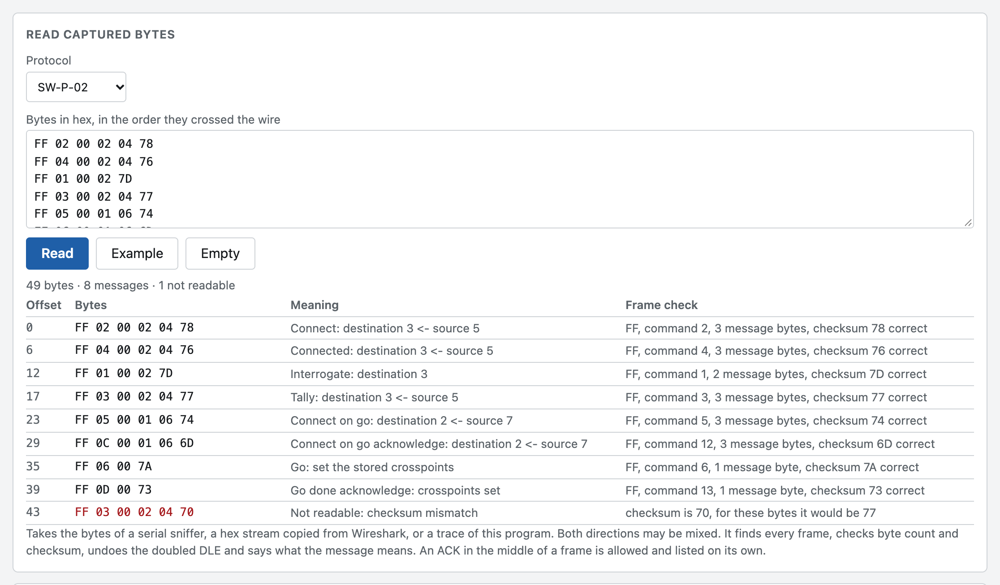

## Settings: who may reach the program

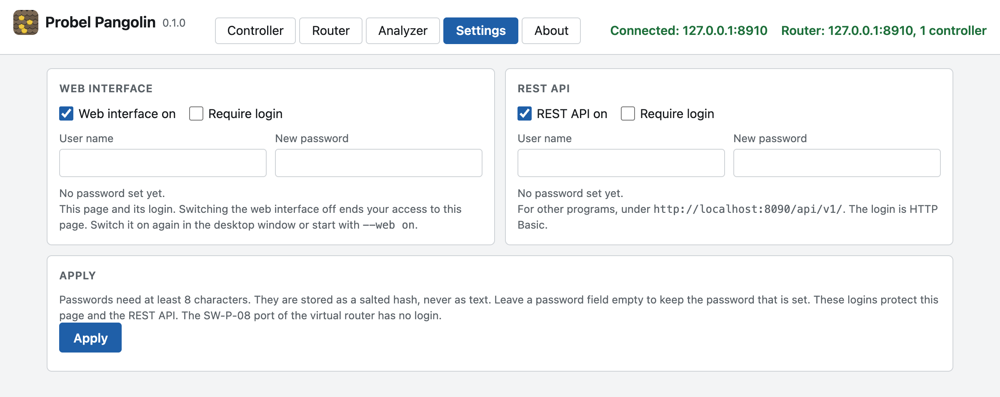

The **Settings** tab, in the window and in the web interface, has two doors:

| Door | Switch | Login |
|---|---|---|
| Web interface | on or off | optional: user name and password, with a login page |
| REST API | on or off | optional: user name and password, as HTTP Basic |

The two logins are independent. With both doors off the port is closed.
Passwords need at least 8 characters and are stored only as a salted scrypt
hash, in `settings.access.json` next to the other settings, readable by the
owner only.

These logins protect the web interface and the REST API. The SW-P-08 port of
the virtual router has no login, because the protocol knows none.

If the web interface is switched off from the web interface, that page stops
working. Switch it on again in the window or start with `--web on`.

Changing the web login from the web interface needs the current password.
Without a web login, only this machine can change the access settings.

## The desktop window

The window has the same five tabs. It talks to the same engines as the web
interface, so both can be open at once.

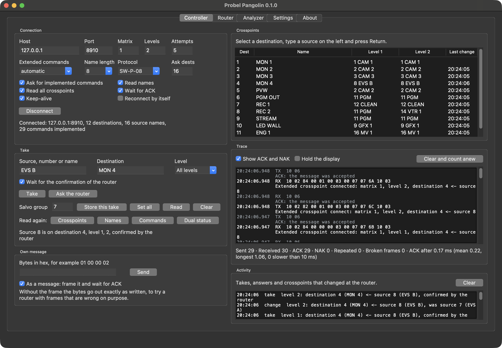

In the **Controller** tab, select a destination in the table, type a source
on the left and press Return. The buttons below do the rest: ask the router,
store the take in a salvo group, set or clear the group, read crosspoints,
names and commands again.

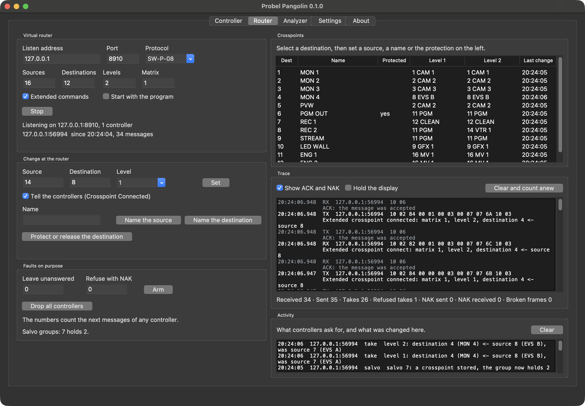

In the **Router** tab, select a destination, then set a source, give it a
name or protect it with the buttons on the left.

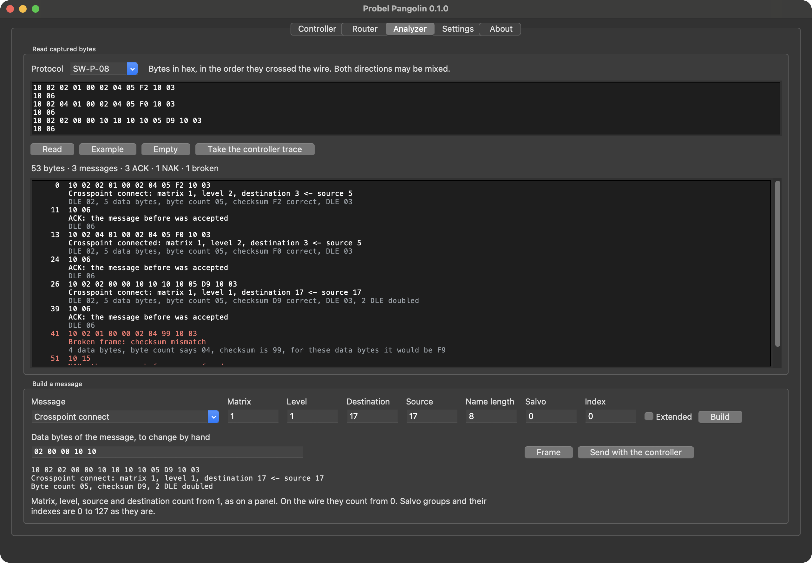

The window has no grid view and edits names one at a time. For those, use the
web interface: its address is in the bottom right corner of the window.

## Where settings are stored

| System | Folder |
|---|---|
| macOS | `~/Library/Application Support/probel-pangolin/` |
| Windows | `%APPDATA%\probel-pangolin\` |
| Linux | `~/.config/probel-pangolin/` |

| File | Content |
|---|---|
| `settings.json` | The controller: protocol, address, options |
| `settings.router.json` | The virtual router: protocol, size, names, protected destinations, crosspoints |
| `settings.access.json` | Switches and logins of web interface and REST API, passwords as hashes |

`--config FILE` uses another `settings.json`, and the two other files next to
it. Deleting the files brings back the defaults.

## Testing a real router

1. In **Controller** enter the address of the router and the port of its
   SW-P-08 (or SW-P-02) interface, the matrix number and the number of levels.
2. Press **Connect**. If the line below the button stays red with "No ACK",
   the port answers TCP but not this protocol, or the router wants another
   matrix number.
3. Look at **Implemented commands**. No list at all means the router did not
   answer the question. That is common with older controllers: switch off
   "Ask for implemented commands" and connect again.
4. No crosspoints after connecting: switch off "Read all crosspoints" and ask
   single destinations with **Ask the router**. Some routers have no tally
   dump.
5. Names look cut or shifted: try another **Name length**.
6. More than 1024 sources or destinations, or more than 16 levels: set
   **Extended commands** to always if automatic does not pick them.
7. Takes work but "Wait for the confirmation" times out: the router does not
   send Crosspoint Connected to this port. Switch the confirmation off, and
   ask the router after a take.
8. Watch **ACK after** above the trace. The specification asks for an ACK
   within 10 milliseconds where possible and allows one second.

SYSTEM2 controllers count matrix and level from 1 on the wire, all others
from 0. For such a controller set Matrix to 2 and add one to the level.

## Testing a controller

1. In **Router** set the size and the names the controller expects, choose
   the protocol and press **Start**. Use `0.0.0.0` as listen address if the
   controller runs on another machine.
2. Point the controller at this machine and the port. It appears under
   **Controllers**, and the trace shows what it asks first.
3. Change a source in the crosspoint table: does the controller follow?
   Switch off **Tell the controllers** and change again: does it find out by
   asking?
4. Protect a destination and take a source to it from the controller: does it
   show that the take was refused, or does it believe its own command?
5. Arm **Leave unanswered** with 1: does the controller repeat the message?
   Arm **Refuse with NAK**: does it repeat, and does it give up cleanly?
6. Press **Drop all controllers**: does it come back, and does it read names
   and crosspoints again?
